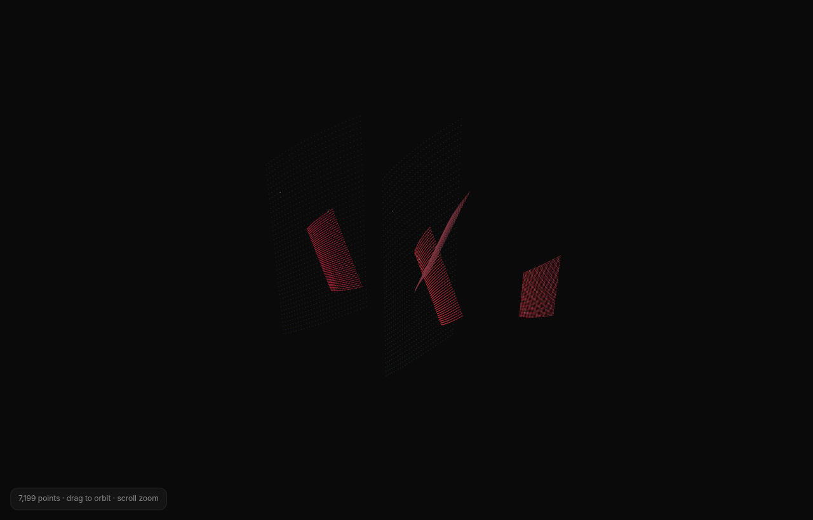

# DashSplat (macOS)

Native macOS app that turns TeslaCam folders into high-quality **3D Gaussian Splats** on Apple Silicon (M1–M4, macOS 14+).

Inspired by the browser tool [aditano/tesla-dashcam-splat](https://github.com/aditano/tesla-dashcam-splat) and Ryan Vogel’s Tesla Reality View.

## What it does

1. Drop / pick a **TeslaCam** root, `SavedClips`, `SentryClips`, `RecentClips`, a single event folder, or loose MP4s.
2. Lists every **separate event** (date/time, duration, cameras, location from `event.json`).
3. For each selected event:
   - Parses Tesla **SEI telemetry** (firmware 2025.44.25+, [teslamotors/dashcam](https://github.com/teslamotors/dashcam) protobuf).
   - Builds a local **ENU trajectory**.
   - Runs **MapAnything** on MLX (`mlx-community/map-anything-apache-fp16`, Apache-2.0) with HW3 intrinsics + poses.
   - Trains / seeds **3DGS** with **OpenSplat (Metal)** when available, otherwise a MapAnything-seeded export.
   - Masks movers (motion / YOLO hook).
4. Orbit the splat in-app and export **`.ply`** / **`.spz`** + `cameras.json`.

## Install (dev)

```bash
# Python pipeline
cd python
python3 -m pip install -e ".[dev]"
# On Mac, for MapAnything:
# python3 -m pip install -e ".[dev,mlx]"

# Synthetic fixtures + tests
python3 tools/generate_synthetic_clip.py --out ../fixtures/synthetic
python3 -m pytest -q
# expect exit code 0

# CLI
export PYTHONPATH=$PWD
python3 -m dashsplat.cli list ../fixtures/sample_teslacam
python3 -m dashsplat.cli build ../fixtures/sample_teslacam --all --no-mlx --force-fallback-trainer --out /tmp/dashsplat-out
```

### macOS app

```bash
brew install xcodegen
./scripts/build_app.sh
# → dist/DashSplat-unsigned.zip
```

### Open an unsigned app

1. Unzip `DashSplat-unsigned.zip`.
2. **Right-click** `DashSplat.app` → **Open** (don’t double-click the first time).
3. Confirm Gatekeeper dialog. Or: System Settings → Privacy & Security → Open Anyway.

First launch runs `dashsplat bootstrap` into  
`~/Library/Application Support/DashSplat/` (venv + models). Progress shows in the sidebar.

## CLI

```bash
dashsplat <folder> [--event ID] [--all]
dashsplat list <folder> [--json]
dashsplat build <folder> --event 2025-11-20_14-03-12 --out ~/Desktop/out
dashsplat bootstrap
```

Exit codes: `0` ok · `2` no events · `3` no frames · `130` cancelled · other = tool failure.

## Trainer choice

**Primary: OpenSplat (Metal/MPS).** It builds reliably with Homebrew PyTorch + Xcode Metal, exports `.ply` and `.spz`, and matches COLMAP/nerfstudio layouts. See [docs/ARCHITECTURE.md](docs/ARCHITECTURE.md).

If `opensplat` is missing, DashSplat still produces a seeded `.ply` / stub `.spz` from MapAnything points so the viewer and exports work.

## Expected runtime

Per ~1–2 minute four-camera event on M2/M3 Pro: **~3–10 minutes** with OpenSplat (1.5–3k iters); **&lt;30 s** for the seeded fallback path used in CI/smoke tests.

## Project layout

```
Apps/DashSplat/     SwiftUI front end + WKWebView viewer
python/dashsplat/   SEI, events, MapAnything, train, CLI
viewer/viewer.html  Orbit / drag splat viewer
scripts/            build_app.sh, run_tests.sh
.github/workflows/  macos-14 CI (pytest + xcodebuild + .app zip)
```

## Screenshots




UI chrome matches the Tesla-style dark web tool; the viewer shot is a live WebGL orbit of a smoke-pipeline `.ply` (7k seeded Gaussians). The unsigned `.app` zip is produced by the macOS CI job (`DashSplat-unsigned` artifact).

## Limitations (honest v0)

- OpenSplat must be installed separately for full GPU training; CI uses the seeded fallback.
- YOLO Core ML weights are optional; default mask is frame-differencing.
- Moving-object **per-track splat groups** are stubbed (static-first path ships).
- Stub `.spz` is DashSplat JSON-gzip when OpenSplat is absent — real Niantic SPZ comes from OpenSplat.
- HW3 extrinsics are approximate; edit `python/dashsplat/cameras.py`.

## License notes

- App + pipeline: see repository license.
- MapAnything Apache weights: Apache-2.0 (`mlx-community/map-anything-apache-fp16`).
- OpenSplat: its own license (AGPL for some Metal pieces) — install separately if you use it.
