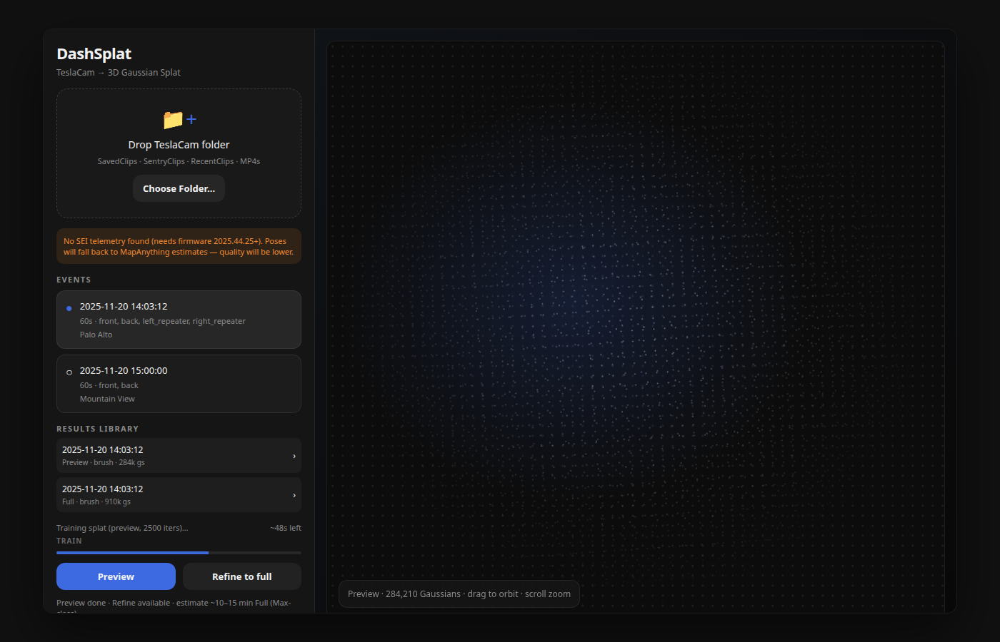

# DashSplat (macOS)

Native macOS app that turns TeslaCam folders into high-quality **3D Gaussian Splats** on Apple Silicon (M1–M4, macOS 14+).

Inspired by the browser tool [aditano/tesla-dashcam-splat](https://github.com/aditano/tesla-dashcam-splat) and Ryan Vogel’s Tesla Reality View. Ideas and patterns also draw from [R44VC0RP/dashsplat](https://github.com/R44VC0RP/dashsplat) (Apache-2.0) — credited wherever we reuse approaches (ego masks, mover filtering, per-camera timing).

## What it does

1. Drop / pick a **TeslaCam** root, `SavedClips`, `SentryClips`, `RecentClips`, a single event folder, or loose MP4s.
2. Lists every **separate event** (date/time, duration, cameras, location from `event.json`). Multi-select / `--all` queues a batch; events stay strictly separated.
3. **Preview** (~estimate: 2 min / 1-min event on Max-class), then **Refine to full** (~estimate: 10–15 min). Stage progress + ETA in the sidebar; results land in an in-app library.
4. Per selected event the pipeline:
   - Detects encrypted clips / missing SEI with a clear message.
   - Parses Tesla **SEI telemetry** (firmware 2025.44.25+, [teslamotors/dashcam](https://github.com/teslamotors/dashcam) protobuf) → **ENU** trajectory.
   - Distance keyframes (Preview ~1/3 m max 60/cam; Full ~1/1 m max 300/cam), skip blurry + hard turns; ~100 m tiles / 20 m overlap.
   - **MapAnything** on MLX (`map-anything-apache-fp16`, Apache-2.0) with HW3 intrinsics + SEI poses, 16-view multi-camera windows. NC weights are opt-in only.
   - Masks: HW3 ego-car + skyseg-coreml + RF-DETR movers (parked cars kept). No ultralytics.
   - Per-camera color/exposure match + time-offset table.
   - Trains with **Brush** (default, Apache-2.0 Metal) or **msplat** (speed); **seeded** fallback for CI / missing Metal.

## Install (dev)

```bash
# Python pipeline
cd python
python3 -m pip install -e ".[dev]"
# On Mac, for MapAnything:
# python3 -m pip install -e ".[dev,mlx]"

# Synthetic fixtures + tests
python3 tools/generate_synthetic_clip.py --out ../fixtures/synthetic
python3 -m pytest -q
# expect exit code 0

# CLI
export PYTHONPATH=$PWD
python3 -m dashsplat.cli list ../fixtures/sample_teslacam
python3 -m dashsplat.cli build ../fixtures/sample_teslacam --all --tier preview --no-mlx --force-fallback-trainer --out /tmp/dashsplat-out
python3 -m dashsplat.cli refine ../fixtures/sample_teslacam --event <ID> --no-mlx --force-fallback-trainer --out /tmp/dashsplat-out
python3 -m dashsplat.cli bench ../fixtures/sample_teslacam --event <ID> --trainer seeded
```

### macOS app

```bash
brew install xcodegen
./scripts/build_app.sh
# → dist/DashSplat-unsigned.zip
```

### Open an unsigned app

1. Unzip `DashSplat-unsigned.zip`.
2. **Right-click** `DashSplat.app` → **Open** (don’t double-click the first time).
3. Confirm Gatekeeper dialog. Or: System Settings → Privacy & Security → Open Anyway.

First launch runs `dashsplat bootstrap` into  
`~/Library/Application Support/DashSplat/` (venv + models + trainers). Progress shows in the sidebar.

## CLI

```bash
dashsplat list <folder> [--json]
dashsplat build <folder> [--event ID] [--all] [--tier preview|full] [--trainer brush|msplat|seeded]
dashsplat refine <folder> --event ID   # forces --tier full
dashsplat bench <folder> --event ID
dashsplat bootstrap
```

Exit codes: `0` ok · `2` no events · `3` no frames · `4` encrypted / blocked · `130` cancelled · other = tool failure.

## Trainer choice

**Default: Brush (Apache-2.0, Metal)** with masks + splat cap. **msplat** is the speed option. **seeded** keeps CI/smoke green when Metal trainers are absent. OpenSplat / gsplat-mps (AGPL) are not used. See [docs/ARCHITECTURE.md](docs/ARCHITECTURE.md). Note: **mpsplat** is Apache-2.0; **gsplat-mps** is AGPL.

## Expected runtime (estimates)

Targets for a ~1-minute four-camera event on an **M-series Max** (base chips slower — UI shows ETA):

| Tier | Estimate |
| --- | --- |
| Preview | ~2 min |
| Full (Refine) | ~10–15 min |

These are **estimates** from research notes, not measured CI numbers. Seeded fallback used in CI is typically &lt;30 s. Measure with `dashsplat bench`.

## Project layout

```
Apps/DashSplat/     SwiftUI front end + WKWebView viewer
python/dashsplat/   SEI, events, MapAnything, trainers, masks, CLI
viewer/viewer.html  Orbit / drag splat viewer
scripts/            build_app.sh, run_tests.sh
.github/workflows/  macos-15 CI (pytest + xcodebuild + .app zip; app still targets macOS 14+)
docs/research/      Method notes (2026-11-22 / 2026-11-23)
```

## Screenshots




UI chrome matches the Tesla-style dark web tool; the viewer shot is a live WebGL orbit of a smoke-pipeline `.ply`. The unsigned `.app` zip is produced by the macOS CI job (`DashSplat-unsigned` artifact).

## Limitations (honest v1)

- Brush / msplat must be bootstrapped on a Mac; CI uses the **seeded** fallback.
- Skyseg Core ML + RF-DETR weights are optional; geometric / stub masks run when models are missing.
- Moving-object **per-track splat groups** remain stubbed (static-first path ships; parked cars kept).
- Stub `.spz` is DashSplat JSON-gzip when Metal trainers do not emit Niantic SPZ.
- Held-out **PSNR in `bench` is a geometric proxy**, not photometric render PSNR.
- HW3 extrinsics are approximate; edit `python/dashsplat/cameras.py`.
- Preview/Refine ETA priors are estimates until local `bench` calibrates them.
- Real TeslaCam footage (encrypted clips, HW3 color, multi-event library UX) needs on-device validation — not covered by CI fixtures.

## License notes

- App + pipeline: see repository license.
- MapAnything Apache weights: Apache-2.0 (`mlx-community/map-anything-apache-fp16`). NC weights: personal-use toggle only.
- Brush / msplat / mpsplat: Apache-2.0. OpenSplat and ultralytics are **not** dependencies.
- Credit: [R44VC0RP/dashsplat](https://github.com/R44VC0RP/dashsplat) (Apache-2.0).
