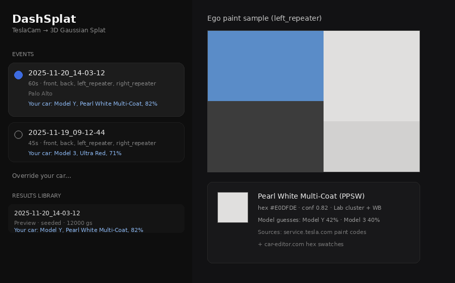

# Ego vehicle identity (paint + make/model)

DashSplat identifies the **owner's car** from TeslaCam repeater views and surfaces it in the event list, results library, and `dashsplat list --json`.

## Paint color

1. Sample RGB pixels inside the existing per-camera **ego mask** on `left_repeater` / `right_repeater` (and pillars when present).
2. Skip overexposed / very dark / low-chroma specular pixels.
3. White-balance using midtone **sky** (top) and **road** (bottom) references.
4. Convert to **Lab**, k-means cluster, pick the dominant body cluster.
5. Map to the nearest **Tesla factory paint** (code + approximate display hex).

**Paint name/code source:** Tesla Service Manual *Vehicle and Wheel Paint Codes*  
https://service.tesla.com/docs/ModelY/ServiceManual/2025/en-us/GUID-769C9625-76EE-467B-B756-C9032AC2B99A.html  

**Approximate hex swatches** (for Lab nearest-neighbor only):  
https://www.car-editor.com/tools/paint-code/tesla/

Returns `{name, code, hex, confidence}` — never a hard claim above ~0.92 without override.

## Make / model

Tesla is implied by TeslaCam. Soft ranking among Model 3 / Y / S / X (plus Highland / Juniper when HW4 pillars appear) using:

- Camera set + HW generation
- Repeater silhouette / fender-curve / mounting-height proxies
- SEI hook (current public SEI has no model field)
- Optional vision-LLM (`DASHSPLAT_VISION_LLM=1`) — **off by default**, stub in this build

No AGPL / non-permissive on-device car classifier is bundled. Always returns **top guesses with confidence**.

## Override

```bash
dashsplat ego-override --model "Model Y" --paint "Pearl White Multi-Coat"
dashsplat ego-override --clear
```

Override is stored under Application Support (`ego_override.json`) and:

- Replaces the displayed identity (confidence 1.0)
- Adjusts the **ego mask profile** (slightly taller body region for Model Y / X)

## CLI / UI

- `dashsplat list --json` → `ego_identity` + `ego_summary` (`Your car: Model Y, Pearl White Multi-Coat, 82%`)
- Swift event + library rows show `ego_summary`; sheet to override

## Tests

`tests/test_ego_identity.py` — synthetic repeater frames of known body colors (white, red), paint catalog, model heuristics, override, list JSON enrichment.


